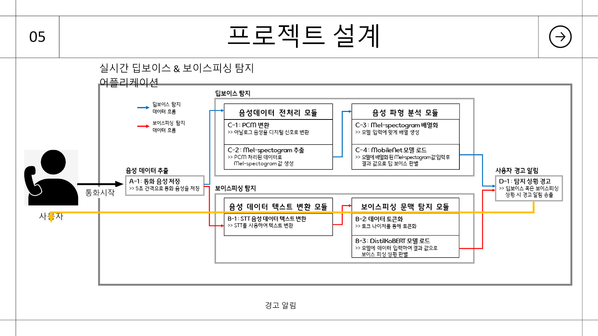
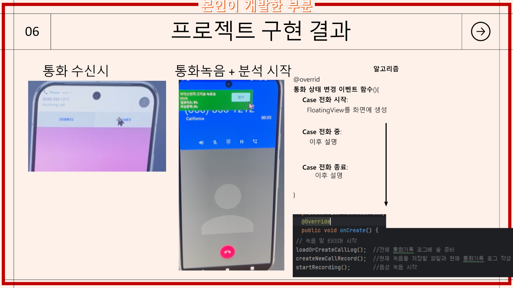
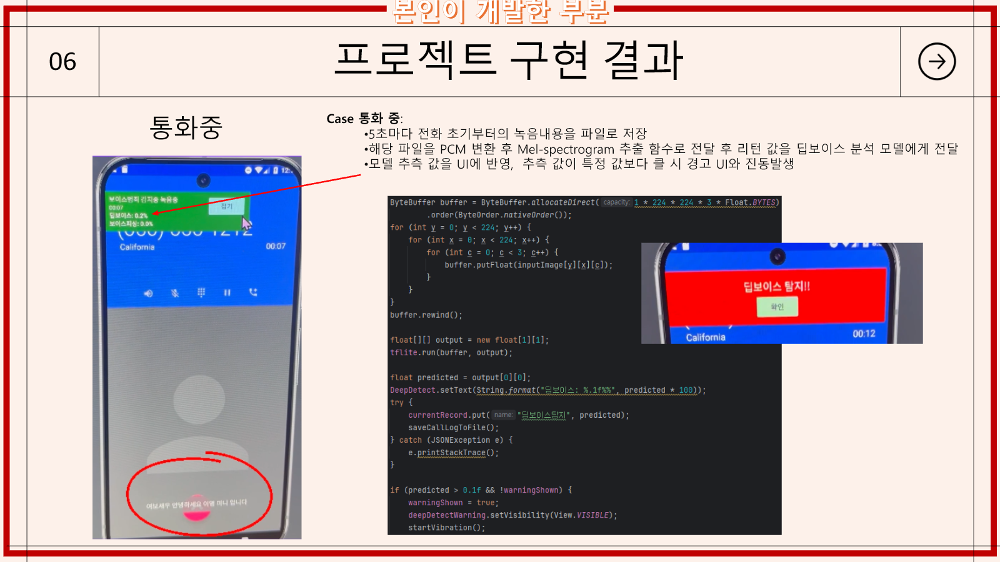
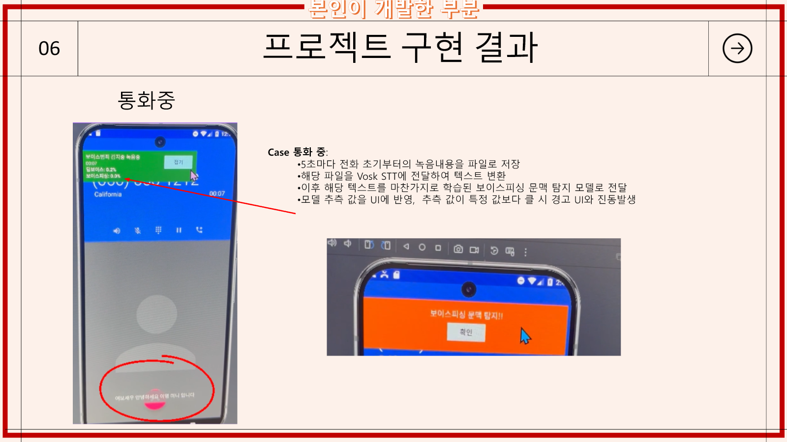
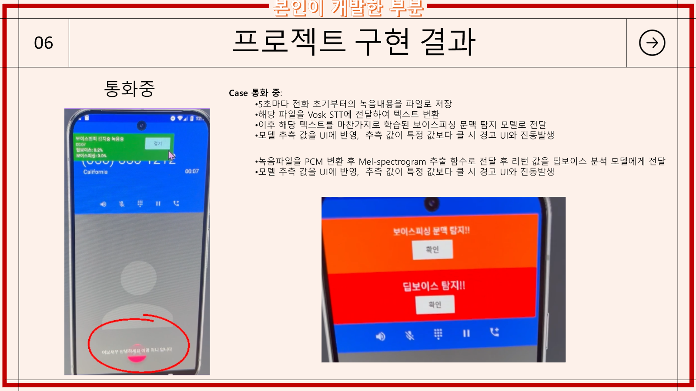
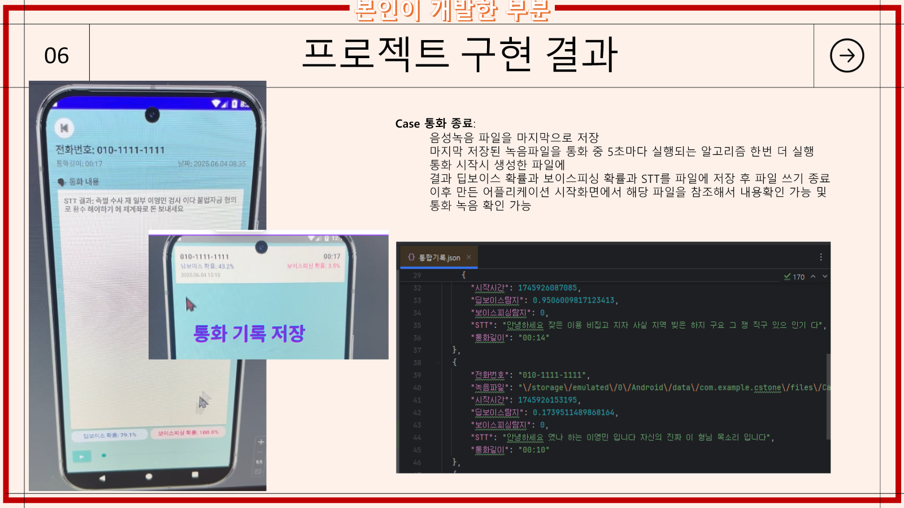
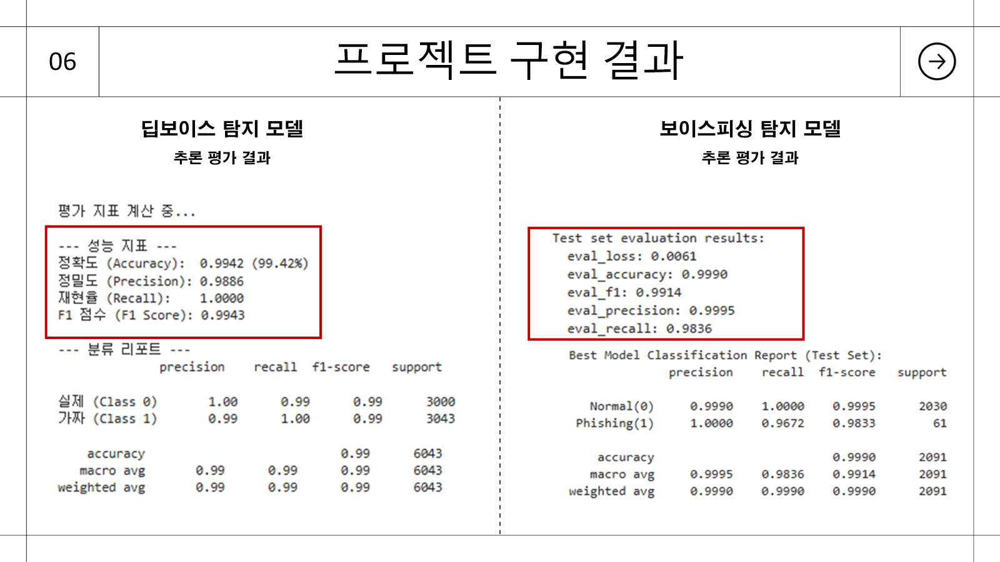

# AI Voice Phishing & Deep Voice Detector — Vibe Coding Portfolio

2024.07~2025.07 캡스톤디자인 팀 프로젝트에서 개발한 Android 기반 보이스피싱 문맥·딥보이스 탐지 애플리케이션의 공개용 코드 정리본입니다.

이 저장소는 완전한 당시 Android Studio 프로젝트가 아닙니다. 원본 Git 저장소가 남아 있지 않아, 최종 발표자료에 보존된 설계·구현 화면·코드 캡처와 당시 구현 흐름을 기준으로 Android 앱 코드를 공개 가능한 형태로 복원했습니다. 학습 데이터셋, 모델 파일, 다른 팀원의 모델 학습 코드, 실제 통화 녹음과 개인정보는 포함하지 않습니다.

## 기여 범위 한눈에 보기

**모델 학습만 다른 팀원이 담당했고, Android 애플리케이션의 설계와 코딩은 모두 이영민이 담당했습니다.**

통화 상태 감지부터 녹음, 5초 주기 분석, 음성 전처리, 학습된 모델 연동, STT, Flask 서버 통신, 경고 오버레이·진동, JSON 통화 기록과 조회 화면까지 앱 동작 전체를 구현했습니다.

## 프로젝트 목표

통화 중 녹음 내용을 5초 간격으로 분석해 두 위험을 사용자에게 알리는 애플리케이션을 구현했습니다.

- 음성 파형 기반 딥보이스 탐지
- STT 텍스트 기반 보이스피싱 문맥 탐지
- 탐지 확률 실시간 표시
- 임계값 초과 시 경고 UI와 진동
- 통화 종료 후 STT·탐지 확률·녹음 파일 기록 조회

## Android 앱 전체 개발 범위

- Android 통화 녹음 기능
- 통화 상태별 시작·분석·종료 흐름
- 5초 주기 녹음 스냅샷 생성
- PCM 변환과 Mel-spectrogram 전처리
- TensorFlow Lite 딥보이스 모델 연동·추론
- Vosk STT 연동
- Flask 서버의 보이스피싱 문맥 모델 호출과 응답 파싱
- 실시간 오버레이 확률 표시
- 위험 경고 UI와 진동
- 통화 기록 JSON 저장과 목록 조회
- 모델 탑재 후 Android 에뮬레이터·기기 테스트

## 처리 흐름

1. 통화가 시작되면 오버레이 화면과 통화 기록을 생성하고 녹음을 시작합니다.
2. 통화 중에는 5초마다 현재까지의 녹음 스냅샷을 저장합니다.
3. 같은 음성 파일을 두 분석 경로로 전달합니다.
   - `PCM → Mel-spectrogram → TFLite`로 딥보이스 확률 계산
   - `Vosk STT → Flask 문맥 탐지 모델`로 보이스피싱 확률 계산
4. 두 확률을 오버레이에 표시하고 임계값을 넘으면 경고 UI와 진동을 실행합니다.
5. 통화 종료 시 마지막 분석을 수행하고 STT·확률·녹음 위치·통화 시간을 기록합니다.

## Vibe Coding 방식

이 프로젝트는 Agent가 저장소 전체를 자율적으로 분석·수정한 Agentic Coding이 아닙니다. 당시에는 GPT에게 필요한 함수의 구현 방법, 라이브러리 연결 방식과 오류 원인을 질문하고, 답변으로 얻은 코드 조각을 Android Studio 프로젝트에 직접 옮겨 기존 코드와 연결했습니다. 이후 에뮬레이터와 실제 기기에서 통화 흐름·모델 입력·경고 UI를 반복 검증했습니다.

즉, `질문 → 코드 조각 생성 → 수동 통합 → 실행 오류 재질문 → 기기 검증`을 반복한 Vibe Coding 프로젝트입니다.

## 공개 코드

- 통화·주기 실행: `CallStateController`, `FiveSecondAnalysisLoop`
- 녹음·파일 변환: `RecordingSnapshotManager`, `PcmToWavConverter`
- 음성 분석: `AudioPreprocessor`, `DeepVoiceAnalyzer`, `VoskSpeechToText`
- 서버 연동: `FlaskVoicePhishingClient`
- 경고 UX: `WarningPolicy`, `FloatingWarningController`
- 기록 저장·조회: `CallLogRecord`, `JsonCallLogStore`, `CallHistoryReader`
- 전체 조정: `CallAnalysisCoordinator`

대표 파일:

- [`AudioPreprocessor.java`](src/main/java/com/y0x79min/voiceguard/analysis/AudioPreprocessor.java): PCM 로드와 Mel-spectrogram 입력 생성
- [`DeepVoiceAnalyzer.java`](src/main/java/com/y0x79min/voiceguard/analysis/DeepVoiceAnalyzer.java): TFLite 입력 버퍼 구성과 추론
- [`CallAnalysisCoordinator.java`](src/main/java/com/y0x79min/voiceguard/call/CallAnalysisCoordinator.java): 5초 분석, STT, 로그 저장, 경고 흐름 조정
- [`FlaskVoicePhishingClient.java`](src/main/java/com/y0x79min/voiceguard/phishing/FlaskVoicePhishingClient.java): STT 텍스트 전송과 문맥 탐지 확률 파싱
- [`JsonCallLogStore.java`](src/main/java/com/y0x79min/voiceguard/storage/JsonCallLogStore.java): 통화별 결과 저장과 조회

## 구현 증거

| 통화 분석 | 딥보이스 경고 | 보이스피싱 문맥 경고 | 동시 경고 |
|---|---|---|---|
|  |  |  |  |

통화 종료 후에는 STT, 두 탐지 확률과 녹음 파일을 통화 기록으로 저장해 다시 확인할 수 있도록 구현했습니다.

## 저장소 범위와 제한

- 모델 학습을 제외하고 본인이 개발한 Android 앱 흐름을 모듈 단위로 정리했습니다.
- 학습 모델과 데이터셋은 용량·저작권·개인정보 문제로 제외했습니다.
- 다른 팀원이 담당한 모델 학습 코드는 포함하지 않았습니다.
- 원본 프로젝트가 보존되지 않아 이 저장소만으로 APK를 빌드할 수는 없습니다.
- 공개 코드는 발표자료의 함수명·코드 캡처·앱 처리 흐름을 기준으로 복원했으며, Android 프레임워크와 모델 파일이 필요한 연결부는 인터페이스로 분리했습니다.

## 팀 프로젝트 결과

최종 발표자료 기준 모델 추론 평가 결과입니다. **모델 학습은 다른 팀원이 담당했습니다.** 본인은 학습된 모델을 받아 Android 앱의 통화·녹음·전처리·추론·STT·서버 통신·경고·기록 흐름 전체를 설계하고 코딩했습니다.

- 딥보이스 모델: 정확도 99.42%, F1 0.9943
- 보이스피싱 문맥 모델: 정확도 99.90%, F1 0.9914

